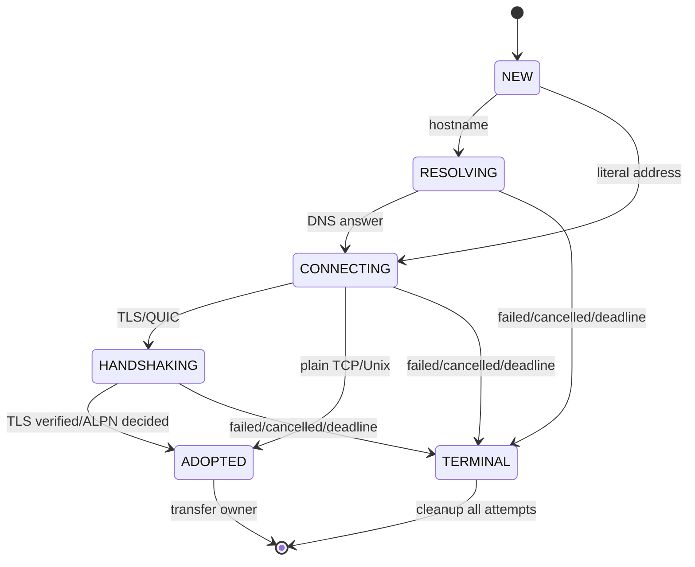
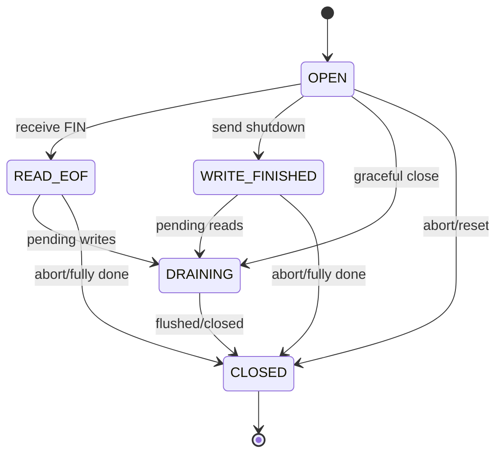

# Runwire 3.0 — U00 unified networking contract, failure and ownership specification

**Status:** Design contract, not shipping code. **Baseline:** published Runwire 2.1.2 at `7e9bf20ad0737a187dfed77b723791b141b36378`. **Scope:** Runwire-owned event loops, accepted/dialed streams, QUIC, UDP, asynchronous DNS and filesystem. To accept implementation tasks later, add executable illegal-transition and fault tests across all relevant backends.

## 1. Authority and ownership

- One root `Runtime` owns a worker/scope tree; host-owned worker pools are external and may not be forked/scaled by Runwire.
- **Pending DNS/dial/TLS attempts** own their temporary sockets, timers, DNS waiters and writable/readable readiness registrations. They must transfer exactly one verified resource to the established connection factory on success; no partial or unverified socket may leak into the established stream API.
- **Established connections** own a live stream, receive/send buffers, watermark decisions, read/write watchers, idle/lifetime timer handles and callback adapter until deliberate transfer or final close.
- **Per-QUIC stream** owns its FIN, reset and STOP_SENDING state; session owns QUIC connection and datagram queues. A reset stream must never reset unrelated streams without an actual connection-level transport failure.
- **Datagram endpoints** own packet queues and peer addressing. No EOF or ordered-stream abstraction is exposed for UDP.
- **File handles/jobs** own executor references and source cancellation tokens; executor capacity and file FD must be reclaimed on terminal completion, failure, or shutdown.
- Each resource has exactly one owner and at most one terminal release. Ownership transfer is explicit, audited and observable. Never fork a live client/pool/file-executor handle without closing/reestablishing it in the child.

## 2. Proposed pending outbound transport state machine

**Invariant:** no path from TERMINAL to CONNECTING/ADOPTED; no second ADOPTED handoff. Cancellation of the losing IPv4/IPv6 racing attempt must not affect the already adopted winner. Client TLS verification must be complete before ADOPTED.

## 3. Established stream contract

In an actual implementation use **independent read/write EOF flags** plus an explicit terminal state rather than blindly adding enum cases. A read EOF does **not** discard admitted pending outbound bytes. Writes after local write shutdown are rejected. An already CLOSED connection never reopens, reallocates a watcher or changes its terminal close reason.

| I/O event | Required observable behavior | Error/cancellation semantics |
| --- | --- | --- |
| Empty read with peer FIN | Read side closes after buffered bytes are consumed | Distinct from timeout, protocol error or cancelled request |
| Peer TCP RST | Terminal connection-level failure | Complete waiting readers/writers exactly once |
| Read watcher ready with zero bytes but no EOF | No data admission | Return to scheduler; no spin-loop |
| Partial write / `EAGAIN` | Retain remaining bounded queue | Keep write watcher; reject on max budget |
| Remote slow receiver | Writes paced by send budget/watermark | Explicit backpressure error or await policy |
| Graceful close | Stop admitting new writes, drain accepted data, close on deadline | A forced stop overrides only with explicit terminal reason |
| Concurrent close/cancel/timeout | One terminal state and callback | Second completion is ignored, not re-dispatched |
| Scope shutdown | Owned socket, timer and watcher released once | Transferred worker-owned socket exempt only if explicit |

## 4. Transport-specific differences

| Transport | Data model | Completion/failure | Required limits |
| --- | --- | --- | --- |
| TCP / Unix | Ordered bytes, independently half-closeable | FIN/EOF vs RST/broken pipe | Receive/send buffers, accepted/pending connections, read/write work per tick |
| TLS over TCP | Ordered encrypted bytes after verification | close_notify vs truncation/EOF vs validation error | Handshake time, credential policy, record buffer, per-worker handshake admission |
| UDP | Individual unordered datagrams | Datagram loss/truncation; no ordered EOF | Per-message MTU, pending packet queue, peer routing, total bytes |
| QUIC | Session plus independent streams/datagrams | Stream FIN/STOP_SENDING/RESET vs connection-level close | Session/stream flow credits, poll budget, pending crypto, per-peer quotas |
| DNS | Resolved addresses only, not a connection | NXDOMAIN, refusal, cancellation, timeout | Inflight resolver workers, queue, TTL and address racing attempts |
| Filesystem | Offset, partial operation and file handle | Error, cancellation or completed operation | Executor workers, queue, open FD and concurrent operation slots |

## 5. Deadlines, failure precedence and resource accounting

- **Monotonic total deadline** is inherited from scope; stage-specific DNS/TCP/TLS/file timeouts may shorten but not silently extend it.
- Cancellation must be idempotent; race resolution occurs in a single completion arbiter. Error precedence is whichever terminal event wins after entering the arbiter, recorded with originating operation and stage for diagnostics.
- **No silent retry of application payload** after HTTP/QUIC reset, TLS/connection error or partial write. Only explicitly safe/idempotent higher-level policy can retry.
- Every accepted socket, dial attempt, TLS handshake, executor job, QUIC stream and pooled connection consumes separately tracked admission counters. Applying a per-connection `ConnectionLimits` object does not replace aggregate worker/scope admission limits.
- Existing 2.1.2 connection defaults: receive/send buffer maximums are 1 MiB each, high watermark 512 KiB and low 256 KiB. New defaults must be measured, deliberate and individually testable; do not silently remove legacy limits.
- QUIC 0-RTT application dispatch stays disabled without a verified replay policy.
- Request and hosted-runtime shutdown cannot invent ownership over a host-owned event loop or worker pool. If genuinely asynchronous backend support is unavailable, report capability failure.

## 6. Required executable proof before state-machine closeout

Future U00.04/U02/U03/U04/U05/U06 tasks must add tests for illegal state transitions, success/timeout/cancel races, no duplicate callbacks, buffer bounds, EOF half-close, TLS validation, QUIC stream-local reset, UDP packet boundary, fork/recycle and executor death. **A state diagram alone does not close those engineering gates.**
