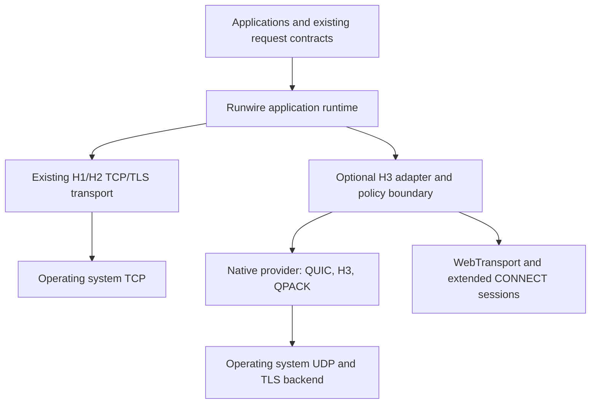

# Runwire — full HTTP/3, QUIC and WebTransport implementation plan

**Status:** Proposed / not started  
**Prepared:** 2026-11-27  
**Target:** Future Runwire release; major/minor number to be decided at kickoff  
**Scope:** Runwire and its optional native transport provider only  
**Baseline:** The eventual released H1/H2-only Runwire version, to be recorded at kickoff  
**Release policy:** No merge, tag, publication or dependency migration is authorized by this plan.

## 1. Objective and definition of full support

Reintroduce HTTP/3 as a production-grade native client and server, backed by a maintained QUIC implementation. Provide complete HTTP semantics, correct QPACK, independent streams, secure outbound connections, bounded resource ownership and independently verified interoperability. Deliver advanced transport features, WebSocket over H3 and WebTransport, without regressing HTTP/1.1, HTTP/2, TCP/UDP, existing WebSocket or gRPC/H2 behavior.

The earlier Runwire native H3 implementation was deliberately removed in the 4.0 development cycle. Do not restore that tree wholesale. Audit historical tests and lessons for reuse, not historical capability claims. In particular, native peer-address verification, datagrams and migration must be demonstrated by the chosen provider, not inferred from TLS hostname validation or extension availability.

### Release profiles

| Profile | Required scope | Release rule |
|---|---|---|
| Core H3 | Every P0 requirement, including secure QUIC v1, RFC 9114 and RFC 9204, client/server and native lifecycle | May be an explicitly labeled core-only milestone; not the full initiative |
| Full H3 | All P0 and P1 requirements, including migration, datagrams, WebSocket/H3 and WebTransport | Every required extension qualified or explicitly re-scoped by maintainer; no silent omissions |
| Advanced networking | P2 features such as MASQUE and multipath, specialized hardware/kernel optimizations and experimental RPC transports | Separate opt-in milestones; do not block core/full H3 unless expressly promoted |

P0/P1/P2 are project priorities, **not RFC requirement levels**. A protocol MUST or applicable MUST NOT is mandatory for the claimed implementation regardless of priority. Optional RFC features can be disabled, but prohibited frames, settings, state transitions and downgrade behavior must still be handled correctly. Full support means the agreed feature profile and conformance matrix, not every possible IETF extension.

## 2. Architecture and ownership



- Native provider owns cryptography, packet parsing/protection, UDP I/O or packet batching, ACK/loss recovery, congestion/pacing, transport state, stream flow control and migration. Prefer mature native H3/QPACK engines too. Do not implement a new QUIC stack in PHP.
- Runwire owns application contracts, request/response conversion, security policies, cancellation, deadlines, runtime integration, fair application scheduling, worker lifecycle, and diagnostics. Enforce policy at the earliest native boundary before protected traffic is sent; native code enforces its own transport invariants.
- Keep raw QUIC transport interfaces protocol-neutral where practical; H3 and WebTransport are distinct negotiated capabilities. Minimize wrappers, allocation, call hops and native/PHP transitions. No generic plugin framework unless multiple actual providers justify it.
- Provider absence must not alter H1/H2 request paths, configuration defaults or package installation requirements. Do not advertise H3 or WebTransport unless that listener is configured, healthy and demonstrably capable.
- One owner per connection and per resource. No implicit global event loop, foreign worker ownership, unsafe FFI, borrowed descriptor closing, polling busy loops, or subprocess per stream/request. If provider integration cannot supply readiness and timer semantics without excessive polling/IPC, reject it.
- Adopt existing protocol-independent Runwire types and APIs where they fit; identify only necessary additive types. Native resource handles are opaque, validated and nonserializable; stream IDs and QUIC integers must retain their full specified range, with an explicit supported platform integer-width policy.

### Backend selection — mandatory before implementation

| Candidate to evaluate | Strength to investigate | Important proof / risk |
|---|---|---|
| C binding + ngtcp2 + nghttp3 | Mature separated native QUIC and HTTP/3 engines | UDP/timers integration, TLS backend compatibility, stream reset and WebTransport support, C memory safety |
| Rust binding + quiche | Integrated native QUIC/H3 | C ABI or Rust/Zend binding, native build reproducibility, session/datagram/reset exposure, memory ownership |
| Rust binding + Quinn + h3 | Modular QUIC and HTTP/3 | Runtime/event-loop boundary, dependency footprint, H3 feature maturity and WebTransport integration |
| Quinn + wtransport | Focused WebTransport capabilities | Not sufficient alone unless general H3 client/server contracts also covered |
| Official PHP transport APIs or maintained external PHP extension available at kickoff | Potentially lower maintenance | Actual capability tests; official installer availability does not imply official maintenance or full protocol coverage |

Do not choose a backend by this table alone. Capture version/release, license compatibility, maintenance history, security response, supported TLS implementations, supported PHP ABIs and OS/CPU architectures. Validate actual numeric pre-dial destination, independent SNI/certificate verification, observed peer/path, migration authorization, reliable resets, datagrams, nonblocking operation and resource lifetimes. Compare native-only and PHP-bound throughput, latency, CPU, RSS and allocation/copy overhead with identical workloads. A provider unable to pass P0 is rejected; inability to satisfy required WebTransport features blocks the full profile. If only a core provider exists, stop at a documented core-only milestone or defer implementation; do not pretend to support missing functions. Separate native provider repository only if justified at kickoff; do not introduce a second maintained native protocol engine.

### Ownership and integration contracts to settle in Batch A

| Boundary | Required contract |
|---|---|
| Endpoint | Bind explicit address; expose local address; poll/drive bounded work; next monotonic timer; controlled shutdown |
| Client connect | Approved numeric destination, independent TLS name/origin, trust settings, ALPN, deadline, cancellation, explicit error result |
| Connection | Owner identity, current validated peer/path, negotiated version/ALPN/capabilities, stream admission, flow credit, close/drain and stats |
| Stream | Stable identity, direction, bounded read/write, partial acceptance, FIN/reset/STOP_SENDING, terminal error, readiness and credit notification |
| Datagram | Negotiated max payload, bounded queues, send acceptance versus actual delivery, drop/expiry semantics; never promise reliability |
| H3 | Control/settings state, typed request/response headers, streaming data, trailers, stream and connection errors |
| WebTransport | Explicit session ID, session-scoped stream/datagram access, admission, close/drain, error mapping and resource isolation |
| Runtime | Single owner event loop; reentrancy-safe callbacks; cancellation settlement exactly once; no publication after terminal state; zero orphan watchers |

Names and signatures are design proposals, not approved APIs. Prefer existing Runwire contracts over duplicate public abstractions.

## 3. Standards register

Refresh every standard, verified erratum, IANA assignment, draft revision and browser implementation at kickoff and release. Do not implement against an unversioned moving draft without recording the selected revision and negotiated behavior. Use the normative text for conformance; the following is a work index, not a replacement for it.

| Scope | Reference |
|---|---|
| QUIC transport, TLS, recovery | [RFC 9000](https://www.rfc-editor.org/rfc/rfc9000), [RFC 9001](https://www.rfc-editor.org/rfc/rfc9001), [RFC 9002](https://www.rfc-editor.org/rfc/rfc9002), [RFC 8999](https://www.rfc-editor.org/rfc/rfc8999) |
| HTTP semantics and caching | [RFC 9110](https://www.rfc-editor.org/rfc/rfc9110), [RFC 9111](https://www.rfc-editor.org/rfc/rfc9111), [RFC 8297](https://www.rfc-editor.org/rfc/rfc8297), [RFC 8470](https://www.rfc-editor.org/rfc/rfc8470) |
| HTTP/3 and QPACK | [RFC 9114](https://www.rfc-editor.org/rfc/rfc9114), [RFC 9204](https://www.rfc-editor.org/rfc/rfc9204), [RFC 7541](https://www.rfc-editor.org/rfc/rfc7541) (Huffman reference) |
| Discovery and origin policy | [RFC 7838](https://www.rfc-editor.org/rfc/rfc7838), [RFC 9460](https://www.rfc-editor.org/rfc/rfc9460), [RFC 9412](https://www.rfc-editor.org/rfc/rfc9412), [RFC 8305](https://www.rfc-editor.org/rfc/rfc8305) |
| TLS identity | [RFC 8446](https://www.rfc-editor.org/rfc/rfc8446), [RFC 9525](https://www.rfc-editor.org/rfc/rfc9525), [RFC 7301](https://www.rfc-editor.org/rfc/rfc7301) |
| QUIC extensions | [RFC 9221](https://www.rfc-editor.org/rfc/rfc9221), [RFC 9368](https://www.rfc-editor.org/rfc/rfc9368), [RFC 9369](https://www.rfc-editor.org/rfc/rfc9369), [RFC 9287](https://www.rfc-editor.org/rfc/rfc9287), [RFC 8899](https://www.rfc-editor.org/rfc/rfc8899), [RFC 10069](https://www.rfc-editor.org/rfc/rfc10069) (multipath; P2) |
| Priority | [RFC 9218](https://www.rfc-editor.org/rfc/rfc9218) |
| WebSocket | [RFC 6455](https://www.rfc-editor.org/rfc/rfc6455), [RFC 8441](https://www.rfc-editor.org/rfc/rfc8441), [RFC 9220](https://www.rfc-editor.org/rfc/rfc9220), [RFC 7692](https://www.rfc-editor.org/rfc/rfc7692) |
| HTTP datagrams, capsules and MASQUE | [RFC 9297](https://www.rfc-editor.org/rfc/rfc9297), [RFC 9298](https://www.rfc-editor.org/rfc/rfc9298), [RFC 9484](https://www.rfc-editor.org/rfc/rfc9484) |
| WebTransport | [H3 draft](https://datatracker.ietf.org/doc/draft-ietf-webtrans-http3/) (revision 17 on 2026-11-27), [overview draft](https://datatracker.ietf.org/doc/draft-ietf-webtrans-overview/) (revision 14), [W3C WebTransport](https://www.w3.org/TR/webtransport/) |
| Partial reliable reset | [QUIC stream resets with partial delivery](https://datatracker.ietf.org/doc/draft-ietf-quic-reliable-stream-reset/) (revision 11 on 2026-11-27); verify current specification before claiming support |
| Optional emerging extensions | [ACK frequency](https://datatracker.ietf.org/doc/draft-ietf-quic-ack-frequency/), [QUIC working group](https://datatracker.ietf.org/wg/quic/documents/) |
| RPC | [gRPC protocol specification](https://github.com/grpc/grpc/blob/master/doc/PROTOCOL-HTTP2.md); H3 mapping requires separate defined contract and independent peers |
| Registries | [IANA QUIC](https://www.iana.org/assignments/quic/quic.xhtml), [HTTP/3](https://www.iana.org/assignments/http3-parameters/http3-parameters.xhtml) |

WebTransport H3 and partial delivery were active Internet-Drafts when this plan was prepared; do not label them final RFC compliance. Revision 17 requires H3 datagram negotiation and reliable stream resets for WebTransport data streams. A reliable capsule is not an unreliable native datagram. Core H3 conformance does not require active server push, WebTransport, gRPC/H3, MASQUE, or multipath. Correct handling of disabled optional capabilities is mandatory.

## 4. Engineering and execution policy

Follow the complete [PHPForge engineering principles](https://github.com/infocyph/PHPForge/blob/main/resources/engineering-principles.md) at kickoff and throughout. Record EXEC-01 (before), EXEC-02 (during/recovery), EXEC-03 (before completion) per batch. Apply all thirteen sections, including cross-cutting controls to existing code as well as new files:

| Section | Required evidence |
|---|---|
| Engineering scope | Scope diff, explicit capability decisions, no unrelated redesign |
| Tooling/workflow | Hosted CI, native builds, lint, PHPForge, review findings resolved |
| Performance | Matched throughput, latency, CPU, RSS and allocation evidence; performance before scalability |
| Runtime compatibility | Supported PHP/runtime matrix, API compatibility and migration ledger |
| Types/control flow | Native and PHP boundary validation, typed errors, exactly-once settlement |
| Classes/files | Before/after file/type counts, new type justification, ownership and call-hop review |
| Request processing | No avoidable copy/serialization, framing and streaming parity |
| Collections/memory | Bounded queues and maps, hot-path complexity, cleanup after cancellation |
| Security/identity | Threat model, policy enforcement, independent peer and replay tests |
| External I/O/caching | Approved endpoint resolution, pool isolation, TTL and cache scope |
| Events/logging | Bounded diagnostic cost, safe redaction, interoperability |
| Dependencies/config | Optional provider, clean install, supported ABI, no implicit activation |
| Runtime/operations | Worker ownership, graceful drain, resource limits, reproducible release evidence |

Execution rules:

- Open a dedicated future feature branch and PR only when authorized. Inventory the full current repository and lock the baseline identity; do not assume the old removed file layout remains current.
- One logical batch = one commit; target roughly 50–100 changed files where natural, never manufacture changes or split a cohesive batch to reach a quota. If a batch must be re-scoped before starting, document the reason and revised dependencies. Push → hosted QA → fix findings → next batch. Record follow-up remediation commits as such, not artificial new feature batches.
- GitHub-hosted workers only; keep workload execution in CI. No manual local qualification, no automatic merging or release. Use supported dependency versions/branches rather than dependency commit pins; exact candidate and baseline identities are evidence provenance, not dependency pins.
- No new analyzer suppressions, blanket skip policies, false positives hidden by excludes, dropped retained tests, lowered thresholds, or benchmark cherry-picking. Capability-absent lanes must test absence; mandatory provider-present lanes must fail if the provider is unavailable.
- Prefer existing maintained protocol engines and narrowly scoped adapters. No duplicate QPACK/HTTP3 state machines, redundant classes or per-frame object churn without evidence. Audit historical Runwire defects and add retained/new independent regressions.
- Keep the register below synchronized in the batch commit. Record immutable SHA, run links, tests, benchmark deltas, actual file counts, outstanding review comments and known limitations. Checkboxes close only after evidence; distinguish implemented from verified.

## 5. Ordered action register

**Initial inventory:** 146 unique actions — 89 P0, 50 P1, 7 P2. All open.

Each item has a unique ID and an observable completion condition. Items are not claimed implemented. Dependency order is A → B → C → D → E → F → G → H → I → J → K → L; C/D may be developed together when the chosen native H3 engine owns both. J is optional P2 scope except P1 proxy functionality. Shared tests and security are required in each batch; L is independent final qualification, not a substitute for earlier tests.

### Batch A — architecture, provider and native integration

**Entry:** approved scope and branch; frozen H1/H2 baseline. **Exit:** provider selection report and hosted proof of required capabilities; no provider means no implementation proceeds.

- [ ] A01 (P0) Inventory current Runwire APIs, event loops, runtime drivers, worker ownership, dependency declarations, CI, docs and public manifests; record baseline source/type counts and existing release evidence.
- [ ] A02 (P0) Review historical H3 removal and defect history; map peer identity, cancellation, flow control, QPACK, reload and outbound regression cases to current contracts.
- [ ] A03 (P0) Produce standards conformance matrix (section/requirement/owner/test/status), review errata and distinguish core from negotiated extensions.
- [ ] A04 (P0) Evaluate native backend shortlist using actual hosted builds and peer/stream/datagram/reset probes, license, maintenance and security review; select or reject with evidence.
- [ ] A05 (P0) Establish PHP ABI, OS, CPU, compiler, TLS backend and packaging matrix; require supported release PHP versions at kickoff; test missing or incompatible provider fail-fast without affecting H1/H2.
- [ ] A06 (P0) Define minimal provider contract and capability report with runtime-negotiated features; avoid speculative multi-provider abstractions.
- [ ] A07 (P0) Design native handle ownership, lifetime/refcount, thread affinity, exception translation, fork restrictions, integer bounds and deterministic destruction.
- [ ] A08 (P0) Prove nonblocking UDP I/O, timer/readiness integration, bounded drive calls and native/PHP event batching; idle loops must not spin.
- [ ] A09 (P0) Prove numeric destination/SNI independence, actual per-connection local and peer identity, policy enforcement before packets and correct shared UDP listener semantics.
- [ ] A10 (P1) Prove migration policy hooks, native datagrams, reliable stream resets and browser-compatible H3/WebTransport capabilities against the selected revision; record blockers.
- [ ] A11 (P0) Produce security threat model and allocation/copy cost baseline; decide whether separate native provider repository is warranted, with maintenance owner and patch process.
- [ ] A12 (P0) Add provider-present and provider-absent hosted jobs, reproducible native build instructions and clean-install/package checks; keep default package free of hard QUIC requirement.

### Batch B — QUIC core and TLS security

**Exit:** independent client/server raw QUIC, validated TLS identity and bounded stream/connection lifecycle under impairment.

- [ ] B01 (P0) QUIC v1 client/server endpoints with IPv4/IPv6, numeric address binding, ephemeral ports and address/port introspection.
- [ ] B02 (P0) Transport parameter validation, version negotiation/downgrade protection, packet number spaces, reserved bits and unknown version/frame behavior per specification.
- [ ] B03 (P0) Validate Initial/Handshake/1-RTT protection, key updates, TLS 1.3 only, ALPN and SNI; reject invalid crypto transitions and unsupported negotiated protocol.
- [ ] B04 (P0) Certificate chains, trust roots/CA file/path, hostname/IP identity validation and expiration; preserve original TLS hostname with numeric dial target.
- [ ] B05 (P0) Mutual TLS and virtual-host certificate selection, explicit trust and verification policy, correct failure reason and no implicit insecure mode.
- [ ] B06 (P0) Address validation, anti-amplification, Retry and stateless reset; bounded token state, expiry, key rotation and integrity.
- [ ] B07 (P0) Bidirectional and unidirectional stream open/accept/half-close, FIN and empty FIN, legal stream IDs, stream limits and lifetime bounds.
- [ ] B08 (P0) RESET_STREAM and STOP_SENDING, final size, reset-before-data, duplicate/late events, cancellation and exactly-once completion.
- [ ] B09 (P0) Stream and connection receive/send credit, blocked frames, consumption-based replenishment, partial I/O and bounded buffered bytes.
- [ ] B10 (P0) ACK ranges, loss detection, retransmission of reliable data, PTO, RTT estimation, reordering, duplicate suppression and packet coalescing; qualify native engine behavior rather than reimplementing it.
- [ ] B11 (P0) Congestion control/recovery and pacing meeting RFC 9002; verify provider's supported algorithm(s), safe defaults and timer behavior.
- [ ] B12 (P0) Path validation, MTU constraints/discovery, black-hole handling and minimum Initial packet rules; distinguish validated path from TLS identity.
- [ ] B13 (P0) Connection IDs, retirement/limits, transport close/error mapping, idle timeout, closing/draining and stateless resets; no duplicate resource ownership.
- [ ] B14 (P0) Native parser bounds, connection/handshake/stream flood admission and per-owner quotas; prove malformed input cannot trigger unbounded memory or application work.
- [ ] B15 (P0) Interoperability against at least two independent QUIC stacks; impairment tests for loss, duplication, reordering, delayed ACK, MTU and close races.

### Batch C — HTTP/3 framing and state machine

**Exit:** RFC 9114 engine interoperates in both directions, including error and disabled-extension handling; no HTTP/1 wire emulation.

- [ ] C01 (P0) Map QUIC connections to H3 roles, ALPN `h3`, one required control stream per side, correct unidirectional stream types and critical stream lifetimes.
- [ ] C02 (P0) Parse bounded QUIC variable-length integers and frame lengths, incremental/fragmented frames and coalesced frames without copying whole bodies.
- [ ] C03 (P0) SETTINGS first-frame and single-use rules; validate duplicates, prohibited values, unknown settings and extension capabilities before use.
- [ ] C04 (P0) DATA and HEADERS frame ordering, initial/final headers, trailers, informational responses and stream FIN/reset behavior.
- [ ] C05 (P0) GOAWAY direction and identifier rules, nonincreasing limits, admission race, accepted stream completion and safe retry eligibility.
- [ ] C06 (P0) MAX_PUSH_ID, CANCEL_PUSH, PUSH_PROMISE and push stream rules when push is disabled or enabled; prevent unauthorized push and enforce ID/credit bounds.
- [ ] C07 (P0) Frame legality by stream type and role; reject prohibited H2-only frame types, reserved misuse and malformed/truncated mandatory frames; ignore unknown frames only where specified.
- [ ] C08 (P0) Correct H3 connection/stream/application error codes and error scope; malformed stream must not unnecessarily terminate siblings or publish partial invalid messages.
- [ ] C09 (P0) Validate pseudo-header sets, ordering, duplicate and forbidden fields, lowercase names, scheme/path/authority and Host consistency; distinguish normal and CONNECT forms.
- [ ] C10 (P0) H3 field section limits and message framing/content length; no Transfer-Encoding chunking, connection-specific headers or H1 upgrade on H3 wire.
- [ ] C11 (P0) Negotiate extensions independently and fail closed on unsupported requested features; handle unknown stream types with bounded resources.
- [ ] C12 (P0) Verify independent reference peers, malformed frames, settings and critical streams; capture exact wire error code and sibling-stream recovery.

- [ ] C13 (P1) Implement opt-in active server push where the provider supports it: promise validation, push-stream correlation, cancellation, cache/origin rules, client push credit and bounded scheduling. Qualify with independent peers; disabled remains the safe default, and never claim browser support without verification.

### Batch D — QPACK

**Exit:** full RFC 9204 encoder/decoder verified with independent vectors and dynamic-state/blocked-stream regressions.

- [ ] D01 (P0) Static table, field representations, prefixed integers and Huffman coding, including invalid padding/EOS and overflow bounds.
- [ ] D02 (P0) Dynamic table insert/duplicate/capacity/eviction semantics, reference tracking and safe memory limits.
- [ ] D03 (P0) Encoder and decoder instruction streams, incremental parsing, critical-stream closure and malformed instruction error scope.
- [ ] D04 (P0) Required Insert Count wrapping, Base and Delta Base, relative/post-base indices and invalid reference detection.
- [ ] D05 (P0) Blocked header sections, SETTINGS limits, stream cancellation, section acknowledgment and Insert Count Increment; unblock only eligible streams.
- [ ] D06 (P0) Independent stream progress under delayed dynamic inserts, resets and cancellation; never deadlock control/encoder/decoder traffic behind application backpressure.
- [ ] D07 (P0) Never-index sensitive fields and separate trust scopes; avoid cross-origin compression leakage and reject unbounded header expansion/CPU work.
- [ ] D08 (P0) Enforce per-connection table, blocked bytes, field section and instruction-queue budgets; release credits and references on all terminal paths.
- [ ] D09 (P1) Adaptive indexing/compression efficiency where provider exposes safe controls; no hidden sensitive-field indexing or unjustified PHP shadow table.
- [ ] D10 (P0) Test normative vectors, randomized encode/decode interoperability with independent engines, delayed/reordered stream delivery and memory/CPU exhaustion cases.

### Batch E — native H3 server and runtime lifecycle

**Exit:** real native server integrated with existing Runwire application contracts, fair bounded multiworker lifecycle and HTTP semantics.

- [ ] E01 (P0) Explicit UDP/H3 listener configuration and TLS identity; optional same-number TCP/UDP service port without coupling lifetimes or breaking existing listeners.
- [ ] E02 (P0) Map H3 requests to existing request/writer/context types and middleware boundaries; no duplicate application request model.
- [ ] E03 (P0) HTTP methods, extension methods, status codes, informational responses (100 Continue, 103 Early Hints), HEAD, 204/205/304 and body/trailer restrictions.
- [ ] E04 (P0) Streaming uploads/downloads, file streaming, multipart forms/ranges, SSE, request trailers and response trailers; preserve existing body/response abstractions.
- [ ] E05 (P0) Content negotiation, compression, cookies, cache validators, redirects and authentication interoperability through existing application layers; no duplicate router or middleware.
- [ ] E06 (P0) Bounded header/body/stream admission and handshake/connection budgets, idle/absolute deadlines, per-IP/tenant policy and slow-consumer handling.
- [ ] E07 (P0) Integrate monotonic timers, readiness, structured concurrency, coroutine/request scopes and cancellation; exact-once settlement with no stale callbacks.
- [ ] E08 (P0) Per-stream and aggregate response pressure, read-side credit and partial writes; bounded fair scheduling and control-stream reserve.
- [ ] E09 (P0) Connection ID-aware worker routing and ownership; prove no cross-worker double dispatch or packet misrouting. Reject unsupported reuseport topology.
- [ ] E10 (P0) Graceful GOAWAY and shutdown, drain deadlines, rolling reload, recycle, crash recovery and bounded cleanup; explicitly define accepted-connection loss on crash rather than promising live migration between workers.
- [ ] E11 (P0) TLS/mTLS, virtual-host/SNI selection and application authority checks; reject cross-tenant reuse, stale writer and inconsistent Host/authority.
- [ ] E12 (P1) Safe reuseport/CID steering where supported, certificate reload/rotation and multi-listener configuration without disrupting healthy retained protocols.
- [ ] E13 (P0) Independent H3 application tests (request/response bytes, errors, cancellation, backpressure, lifecycle), plus mixed H1/H2/H3/TCP/UDP load and crash recovery.

### Batch F — native H3 client and outbound security

**Exit:** strict, reusable H3 client with explicit negotiation, SSRF protection and independent parity with retained clients.

- [ ] F01 (P0) Native outbound request, response, streaming upload/download and trailer handling; shared application-visible HTTP semantics and framing.
- [ ] F02 (P0) Explicit strict H3, approved H1/H2/H3 preferences and fallback policy; fail before network I/O when provider/required capability is absent.
- [ ] F03 (P0) HTTPS origin, certificate name, authority and numeric destination remain separate; resolve once, approve candidates, dial approved address and verify actual path before protected application data. Never trust an intended address as actual peer evidence.
- [ ] F04 (P0) DNS rebinding/SSRF defenses (IPv4/IPv6, mapped/translated forms, ports and address classes); reject disallowed paths before sending, reauthorize all redirects/alternatives.
- [ ] F05 (P0) Alt-Svc parsing, caching/expiry/clear, origin authorization, alternative host and port validation; advertise only verified healthy server capability.
- [ ] F06 (P1) HTTPS/SVCB DNS discovery and ALPN/address hints; hints are not trust or authority; preserve authenticated origin and resolver policy.
- [ ] F07 (P1) IPv4/IPv6 and QUIC/TCP connection racing with bounded attempts, cancel losers, no unauthorized fallback after TLS/policy failure or duplicate non-idempotent request.
- [ ] F08 (P0) Worker-owned persistent connection pool, multiplexed sessions, bounded waiters, per-origin/trust/proxy/tenant keys and health/idle retirement.
- [ ] F09 (P1) Connection coalescing and ORIGIN extension only with valid certificate/origin/route policy, explicit trust boundaries and independently verified no cross-tenant leakage.
- [ ] F10 (P0) Redirect and replay-safe retry policy; distinguish requests never admitted, rejected by GOAWAY, potentially processed and accepted; preserve query-only redirect semantics.
- [ ] F11 (P0) Request/connection deadlines and individual stream cancellation, backpressure on upload/download, response error mapping and zero sibling interference.
- [ ] F12 (P0) Retire draining connections, replace safely after GOAWAY, prevent stale HPACK/QPACK/session references, clear pending waiters on close.
- [ ] F13 (P1) Explicit HTTP proxy route capabilities, verified proxy and destination boundaries; reject unsupported QUIC routes rather than tunneling silently over TCP.
- [ ] F14 (P0) Independent peer matrix covering framing, redirect/retry, bad CA, bad hostname, wrong ALPN, DNS rebinding, numeric peer mismatch, cancellation/deadline and recovery.

### Batch G — advanced QUIC and transport extensions

**Exit:** advanced features separately negotiated, policy-controlled, and proven with impairment tests; required WebTransport substrate available.

- [ ] G01 (P1) QUIC v2 and compatible version negotiation with verified downgrade resistance; version-specific capability and failure diagnostics.
- [ ] G02 (P1) NAT rebinding and connection migration, current validated path introspection, CID continuity, path challenge/response, preferred server address and policy callback before prohibited path traffic.
- [ ] G03 (P1) Reauthorize changed remote address/port against outbound policy and maintain authenticated origin; default-disable active migration when policy cannot be enforced. Test NAT port changes separately from address changes.
- [ ] G04 (P1) Native QUIC DATAGRAM send/receive, negotiated max frame size, payload budget, congestion accounting, bounded queues, expiration/drop counters and no retransmission claim.
- [ ] G05 (P1) Reliable stream resets with partial delivery according to selected revision; reliable prefix, final-size checks, error mapping, out-of-order reset and stream association tests.
- [ ] G06 (P1) TLS resumption, NEW_TOKEN/session tickets, scoped storage/expiry and secret rotation; trust/tenant/policy changes invalidate cached credentials.
- [ ] G07 (P1) 0-RTT default off; explicit replay-safe application policy, server anti-replay design, rejection and 425 recovery without duplicate side effects or privilege escalation.
- [ ] G08 (P1) HTTP priority signals, urgency/incremental scheduling, PRIORITY_UPDATE, fair scheduling and resource budgets independent of attacker-controlled priorities.
- [ ] G09 (P1) HTTP Datagrams and Capsule Protocol negotiation, context/stream association, malformed capsule handling and explicit reliable/unreliable delivery distinctions.
- [ ] G10 (P1) ECN, available congestion-control choices (e.g. CUBIC/BBR), adaptive flow-control windows and PMTU/pacing tuning; measure benefits instead of requiring arbitrary algorithm implementations.
- [ ] G11 (P1) Certificate pinning and OCSP stapling/validation where relevant; explicit trust semantics, no replacement of ordinary hostname/chain validation.
- [ ] G12 (P2) Evaluate ECH, ACK frequency, QUIC greasing and multipath (RFC 10069); enable only supported negotiated features; refresh specifications and avoid speculative implementation.
- [ ] G13 (P1) Independent impairment tests for migration, rebind, datagram loss/size/pressure, reset prefix, resumption and early-data replay; verify fail-closed capability absence.

### Batch H — extended CONNECT, WebSocket and RPC

**Exit:** real RFC 9220 WebSocket and explicit RPC compatibility scope; ordinary HTTP traffic unaffected by session workloads.

- [ ] H01 (P1) Extended CONNECT SETTINGS negotiation, correct pseudo-headers, successful response, session ownership and bounded request-stream conversion; no H1 Upgrade/101 emulation.
- [ ] H02 (P1) Standard CONNECT TCP tunnel semantics, bidirectional streaming/half-close, approved destination and authentication, timeout and quotas.
- [ ] H03 (P1) RFC 9220 WebSocket client/server over H3 with multiple sessions alongside requests, correct origin/subprotocol negotiation and RFC 6455 frame semantics.
- [ ] H04 (P1) Text/binary/UTF-8 validation, fragmentation, ping/pong, close handshake and error handling; existing message API reuse rather than a second WebSocket implementation.
- [ ] H05 (P1) Optional per-message compression, negotiated context limits and memory/CPU abuse prevention; no unsolicited extensions.
- [ ] H06 (P1) Session-scoped cancellation, fairness, backpressure, quotas, authentication and worker drain; ensure sibling HTTP/WS sessions survive isolated failure.
- [ ] H07 (P0) Preserve existing gRPC over H2 and H1 WebSocket compatibility and lifecycle, including all unary/streaming modes and mixed-load regressions.
- [ ] H08 (P1) Define an H3 RPC interoperability profile only if a supported mapping and independent client/server exist; cover unary, server/client/bidirectional streaming, metadata/trailers, compression, deadlines, status, health and drain. Record blocked scope if no interoperable mapping exists; do not advertise standard gRPC/H3 solely because H3 supports streaming.
- [ ] H09 (P2) Qualify gRPC-Web and Connect RPC bridging as separate application profiles with explicit browser/proxy behavior; avoid conflating them with native gRPC/H3.
- [ ] H10 (P1) Independently exercise H3 WebSocket handshakes, fragmented messages, concurrent sessions, compression bombs, cancels, auth and graceful shutdown.

### Batch I — full WebTransport

**Entry:** G04/G05/G09 and extended CONNECT passed. **Exit:** browser and independent native peer interoperability against declared revision; both reliable streams and native unreliable datagrams qualified.

- [ ] I01 (P1) Freeze current WebTransport H3/overview/W3C compatibility profile and required reliable reset revision; record protocol negotiation, settings and browser versions.
- [ ] I02 (P1) Client and server session establishment via extended CONNECT, session identification and negotiated H3 datagram/reset support; reject incomplete capability combinations.
- [ ] I03 (P1) Session admission/authentication, origin validation, application authorization, certificate trust and independent per-session context; no cross-session credential reuse.
- [ ] I04 (P1) Client/server-initiated bidirectional and unidirectional streams, stream-type headers/association, incremental parsing, early-arrival handling and bounded pending association queues.
- [ ] I05 (P1) Session-scoped stream creation/acceptance, half-close, flow control and stream quotas; reliable delivery and application error code mapping, reset with reliable prefix where required.
- [ ] I06 (P1) Native unreliable datagram send/receive, maximum payload discovery and association; explicit queue-full/drop/expiration semantics, no fake reliable fallback.
- [ ] I07 (P1) Multiple concurrent sessions per connection, independent quotas, session flow control, per-stream/per-session/connection aggregate budgets and fairness with ordinary H3 requests.
- [ ] I08 (P1) Session close capsules/codes/reasons, draining, cancellation, timeouts, unknown session/stream handling and bounded cleanup; close one session without destroying healthy siblings unless mandated.
- [ ] I09 (P1) Migration/rebinding compatibility, transport error propagation, reconnect as a new session when necessary, no promised continuation of unreliable data.
- [ ] I10 (P1) Session and datagram observability (active streams, bytes, queue pressure, drops, errors, RTT where scoped), with sensitive payloads excluded.
- [ ] I11 (P1) Browser tests (actual supported Chrome/Edge/Firefox/Safari builds) and independent native clients/servers; record unsupported browsers rather than using a stub.
- [ ] I12 (P1) Combined stream/datagram workloads under loss, reordered packets, congestion, resets, slow readers, malformed association, flooding, cancellation and session drain; prove bounded memory and zero orphan session resources.

### Batch J — proxy, tunneling and optional MASQUE

**Exit:** qualified P1 proxy contracts; P2 scope may remain deferred and unadvertised.

- [ ] J01 (P1) H3 reverse proxy with H1/H2/H3 upstream selection, independent upstream TLS/SSRF approval, request/response streaming and bounded backpressure.
- [ ] J02 (P1) H1/H2 inbound to H3 upstream and H3 inbound to H1/H2 upstream, header/authority normalization, trailers, cancellation and hop-by-hop semantics.
- [ ] J03 (P1) CONNECT tunnel admission, half-close and cancellation, target allowlists, DNS rebinding protection and explicit unsupported protocol error behavior; do not transparently translate WebTransport datagrams into ordinary HTTP.
- [ ] J04 (P2) Optional forward proxy, CONNECT-UDP (RFC 9298) client/server and HTTP datagram context/capsules; enforce destination and quota policy.
- [ ] J05 (P2) Optional CONNECT-IP (RFC 9484) client/server, restricted network access, explicit route/address assignment and packet validation; disabled by default.
- [ ] J06 (P2) MASQUE session ownership, authentication, per-tunnel budgets, migration policy and UDP/IP abuse safeguards; separate threat model before enabling.
- [ ] J07 (P2) Evaluate CID-aware external UDP load balancing and multi-node routing; document limitations (do not invent transparent connection failover).
- [ ] J08 (P1) Proxy independent interoperability and security tests: malformed headers, authority conflicts, failed TLS, redirects, tunnel pressure, cancellation, half-close and scope isolation.

### Batch K — optimization, observability and deployment

**Exit:** production profiles, operational controls and measurable performance improvements or documented non-adoption.

- [ ] K01 (P0) Profile native/PHP crossing count, allocations, copies, callback cost, CPU and RSS; remove avoidable wrapper/type/file/call-hop overhead while retaining semantic owners.
- [ ] K02 (P0) Bounded buffers, O(1)/amortized O(1) lookup, no global scan per packet, bounded timer management, fair stream scheduling and explicit backpressure across layers.
- [ ] K03 (P1) Evaluate native event batching, UDP send/receive batching and GSO/GRO with kernel detection and safe fallback; compare identical workloads, adopt only demonstrated gains.
- [ ] K04 (P1) Tune pacing, congestion, receive credit and connection/stream budgets for LAN/WAN/mobile; protect tail latency and memory under saturation, not just peak RPS.
- [ ] K05 (P2) Evaluate NUMA/CPU affinity, io_uring and multipath scheduling only with actual hardware/provider support and measured benefits; no mandatory sysfs changes.
- [ ] K06 (P0) Bounded connection/stream/handshake/close counters, handshake latency, negotiated ALPN/version, RTT, loss/retransmission and flow-blocked statistics with typed errors.
- [ ] K07 (P0) QPACK occupancy/blocked streams, per-worker and connection memory, request throughput/latency, scheduler/queue limits and resource leak diagnostics.
- [ ] K08 (P1) Datagrams/drop, migration, resumption/0-RTT, bytes-in-flight, congestion window, session/tunnel telemetry and bounded label cardinality.
- [ ] K09 (P1) Export existing structured metrics/logging to Prometheus/OpenTelemetry-compatible integrations, qlog/Wireshark debugging, sampling and explicit redacted TLS key-log debug option (off by default; no production secrets).
- [ ] K10 (P0) Explicit configuration schema and effective capabilities; listener/port, TLS, limits, timeouts, migration, datagrams, WebTransport, congestion and policy validation with safe defaults.
- [ ] K11 (P0) Linux/container install and deployment; verified provider versions, ABI, dependency inventory, health/readiness, shutdown, rollback and no-QUIC H1/H2 install.
- [ ] K12 (P1) Qualify Windows/macOS or explicitly restrict provider to supported platforms; Kubernetes/UDP load balancer and edge proxy examples, NAT/firewall, certificate rotation and routing caveats.
- [ ] K13 (P0) Document client/server/streaming/security/runtime APIs, configuration, failure atlas, upgrade notes and deployment examples; examples executable, no misleading capability flags or blanket performance claims.
- [ ] K14 (P0) Package/ABI/CI/source audit; list new and changed public APIs, count files/types, review extension lifecycle and dependency security, run all existing retained checks.

### Batch L — final certification and release decision

**Entry:** all required implementation items verified with candidate frozen. **Exit:** all chosen profile gates green on exact head; maintainer release decision, no auto-publication.

- [ ] L01 (P0) Complete standards requirement-to-test matrix and independent negative cases, document every unsupported optional extension and verified erratum disposition.
- [ ] L02 (P0) Run full PHPForge thirteen-section audit, Pest/Pint/PHPStan/Psalm/security/package matrix and resolve every review finding, including asynchronous scanning results.
- [ ] L03 (P0) Independent QUIC/H3 client/server interoperability against at least two distinct stacks; real curl/H3 and independent reference peers, exact tool versions and negotiated capabilities recorded.
- [ ] L04 (P1) Browser WebTransport and H3 WebSocket tests, advanced migration/datagram/early-data/reliable-reset tests, H3 RPC profile only where claimed; negative capability tests mandatory.
- [ ] L05 (P0) Native sanitizers, memory/UB/thread-safety checks as applicable, coverage-guided fuzzing for packet/framing/QPACK/session/FFI-boundary parsers; zero unresolved crashes or high severity findings.
- [ ] L06 (P0) Impairment matrix (loss/burst/reorder/duplicate/latency/MTU/rebind), adversarial admission/flow/reset and cross-tenant isolation; no unexpected corruption, hangs or stale events.
- [ ] L07 (P0) Mixed-protocol stress and worker lifecycle, including cancellation/deadline races, accepted stream drain, crash/recycle/reload, watcher cleanup and idle CPU.
- [ ] L08 (P0) Retained H1/H2/TCP/UDP/WebSocket/gRPC regression and extension-absent clean install; all supported PHP/runtime hosts and exact package graphs.
- [ ] L09 (P0) Matched H1/H2 baseline performance and native H3 reference comparison using §6; report throughput, tail latency, CPU, RSS, memory slope and all trial samples.
- [ ] L10 (P0) Minimum 30-minute soak plus proposed 6-hour and 24-hour H3/mixed workloads; retained soak unchanged. Validate resource reclamation, zero unexpected failures and bounded memory slope.
- [ ] L11 (P0) Final reproducible packaging and native extension supply-chain/security review; public migration manifest, feature capability table and deployment/rollback guide.
- [ ] L12 (P0) Freeze candidate identity and run mandatory exact-head jobs; verify no stale checks, no unresolved review threads, no unexpected skipped mandatory jobs, all action IDs linked to evidence. Record decision and do not merge/publish without authorization.

## 6. Production acceptance and measurement protocol

All thresholds here are proposed project acceptance criteria; at kickoff apply the current PHPForge and existing Runwire budgets if stricter. Freeze workload, environment, thresholds and failure classification before comparing versions. Do not relax after seeing results.

| Gate | Proposed minimum acceptance |
|---|---|
| Correctness | 100% expected bytes/status/trailers/terminal outcomes; zero unexpected errors, timeouts, duplicate callbacks, corruption or unauthorized packets. Injected network loss/cancellation is evaluated against declared expected outcomes. |
| Retained H1/H2 performance | Matched published baseline vs candidate, same workload, PHP, dependencies, worker/concurrency, TLS, OPcache, CPU topology. Five alternating paired trials of at least 180s, identical 30s warm-up per measured trial. |
| Variance | Throughput CV strictly below 2.5% for both versions (or stricter current limit); above/equal is inconclusive, not pass. Keep all raw samples. |
| Retained throughput | Candidate no more than 5% median successful RPS regression (stricter existing 2% gate takes precedence where applicable). |
| Retained p95/p99 | Each meets existing relative/absolute tolerance: no regression exceeding both 15% and 0.5 ms. Report p50/p99.9 as well. |
| Retained peak RSS | At most baseline × 1.10 + 4 MiB under identical workload, or stricter existing budget. Report CPU and native/PHP resource footprint. |
| H3 performance | No prior H3 baseline assumed. Establish and freeze native reference workloads and PHP-bound overhead target in A; measure against independent mature H3 engines with equivalent semantics. Establish H3 regression thresholds before tuning; no universal promise of beating C or Rust. |
| Backpressure | Configured stream/connection/session/global limits never exceeded beyond documented bounded transport overhead; accepted bytes and credits reconciled; unrelated streams make progress. |
| Lifecycle | No orphan watchers, timers, jobs, native handles or child ownership; zero active application streams after bounded drain. All terminal callbacks exactly once. |
| Security | No protected application traffic to unapproved destinations; enforce path policy before any prohibited outbound network action; no unauthorized coalescing, replay or cross-session leakage. |
| Native safety | Zero unresolved sanitizer violations, fuzz crashes or known unmitigated critical/high vulnerabilities in the shipped path. Record fuzz time/corpus/coverage. |
| Soak | 30m mandatory plus 6h and 24h proposed full-profile runs. Freeze traffic schedule, RSS slope and resource-return budgets; report process tree and provider-native memory. No unexpected errors or unbounded growth. |
| Compatibility | Every mandatory hosted PHP/OS/ABI profile green, provider-absent tests green; explicit exclusions for unsupported platforms with no advertising. |

### Required workload dimensions

Run risk-based coverage rather than the uncontrolled full Cartesian product. Commit a machine-readable scenario matrix before qualification; distinguish mandatory cases, optional features, impairment parameters, expected outcomes and test owners. Preserve high-risk pairwise combinations and targeted interaction tests.

| Dimension | Representative cases to freeze |
|---|---|
| Protocol | H1, H2, H3, raw QUIC, H3 WebSocket, WebTransport streams/datagrams; proxy/RPC profiles when claimed |
| Payload | Empty, tiny, 1 KiB, 16 KiB, 64 KiB, 1 MiB, multi-MiB and streaming larger-than-buffer; headers/trailers and malformed input |
| Concurrency | 1/16/64/256 active streams; higher up to supported limits and overload beyond configured limits; multiple connections and workers |
| Traffic | Request/response, asymmetric upload/download, SSE, mixed small/large streams, multiplex, cancellation bursts, sustained and bursty datagrams |
| Network | Localhost baseline, 20/100/250ms added RTT, bandwidth limits, 0/0.1/1/5% loss, burst loss, packet reordering/duplication, MTU reduction; fixed reproducible profiles with seeds and observed conditions |
| Paths | IPv4/IPv6, NAT port rebind, approved/unapproved migration, CID rotation, denied DNS destinations, wrong CA/name/ALPN, alternate service redirection |
| Lifecycle | Early/mid/late cancellation, FIN/reset races, GOAWAY, flow-credit exhaustion, critical-stream failure, shutdown/reload/recycle/crash |
| Platform | Current supported PHP versions, native Linux hosts, optional supported OS/architectures, PHP without provider, native/TLS backend version and extension compatibility |

### Measurement and diagnostics

Use GitHub-hosted workers with verified available CPU topology. Alternate baseline/candidate on the same server core, client on separate physical core where available. Record runner identity, topology, CPU/runtime/extension versions, OPcache, workload, transport, TLS, worker counts, all trial durations, request/error counters and resource samples. Keep raw trial artifacts even when the comparison fails; print numeric failure diagnostics. Investigate variance, correctness failures and real regressions separately. If noise is above the ceiling, repeat an entire predeclared matched series on an appropriate hosted runner, retaining all prior evidence; do not drop individual trials or silently rerun until green. Record any change to protocol or workload as a new measurement series. Do not represent H3 benchmark improvements as proof of preserved H1/H2 behavior.

## 7. Security and failure acceptance invariants

These apply throughout; every item maps to the action register and a negative test:

| Boundary | Required failure behavior |
|---|---|
| Absent provider / unsupported extension | Typed unavailability before allocation/network I/O when requested; retained protocols operate normally |
| Unapproved DNS/Alt-Svc/redirect/migration | Reject before disallowed network use; no silent TCP downgrade or trust bypass |
| TLS mismatch / invalid mTLS | Reject handshake/application publication; no insecure retry |
| Invalid H3/QPACK/QUIC input | Correct error scope/code, bounded work and memory; siblings survive isolated stream errors |
| Admission pressure | Bounded queues, documented rejection/flow control, no unbounded application work |
| Cancellation / deadline | Correct terminal reason, settled once, no failed-stream body or late callbacks |
| GOAWAY / retry | Only provably safe retries, accepted work allowed to finish within deadline |
| 0-RTT | Off by default; explicit replay-safe policy, rejection/retry without duplicate effect |
| WebTransport | Negotiate required capabilities; session-bound streams/datagrams, no fake reliability, isolated session close |
| Worker failure | No stale ownership or resource leaks; truthful loss/recovery semantics; retained listeners remain usable |
| Native memory / debug | No dangling pointers, unsafe cross-thread calls, double free, exposed traffic secrets or unbounded logs |

## 8. Progress tracker and evidence ledger

Every batch starts **not started**. Record implementation commit, exact-head QA, open findings and exit decision; update this table in the same batch commit. The full profile is not closed by checkbox counts alone.

| Batch | Dependencies | Implementation | Hosted QA | Evidence / SHA |
|---|---|---|---|---|
| A — Provider | Kickoff | Not started | Not run | — |
| B — QUIC/TLS | A | Not started | Not run | — |
| C — HTTP/3 | B | Not started | Not run | — |
| D — QPACK | B, C | Not started | Not run | — |
| E — Server | C, D | Not started | Not run | — |
| F — Client | C, D, E shared runtime | Not started | Not run | — |
| G — Advanced QUIC | B–F | Not started | Not run | — |
| H — Extended CONNECT/WS/RPC | C–G | Not started | Not run | — |
| I — WebTransport | G, H | Not started | Not run | — |
| J — Proxy/MASQUE | F–I (as relevant) | Not started | Not run | — |
| K — Optimization/operations | E–J required scope | Not started | Not run | — |
| L — Certification | All chosen profile items | Not started | Not run | — |

### Per-batch evidence template

```text
Batch / action IDs:
Candidate SHA / parent / baseline SHA:
EXEC-01 decisions and scope:
Files added/removed/modified; production type count before/after:
Public API changes and rationale:
Native provider version, capability evidence, dependency/ABI changes:
EXEC-02 implementation notes and tradeoffs:
Hosted workflow IDs / job links / artifact links:
Positive, negative, independent-peer and retained regression tests:
Benchmark workload, all sample results, budgets and decision:
Security and resource lifetime evidence:
13-section review results / remaining findings:
EXEC-03 completed, blocked, deferred actions and closure decision:
```

### Decision register (initial)

| ID | Proposed decision | Status |
|---|---|---|
| DEC-01 | Keep current H1/H2-only release independent; future branch only on approval | Proposed |
| DEC-02 | Use mature native protocol engines; choose provider on proof, not language preference | Proposed; backend undecided |
| DEC-03 | Target P0 + P1 full profile; P2 opt-in, no false claims | Proposed |
| DEC-04 | WebTransport revision and reset dependency revalidated at kickoff and final certification | Required |
| DEC-05 | gRPC/H3 not assumed interoperable; decide profile or explicit nonclaim | Open |
| DEC-06 | No automatic merging/publishing, no dependency SHA pins; exact evidence identities recorded | Required |
| DEC-07 | Preserve strict performance limits; proposed H3 overhead budgets established before tuning | Open until Batch A |
| DEC-08 | Native platform/ABI matrix, licensing, staffing and long-term maintenance ownership | Open until Batch A |

### Final sign-off checklist

- [ ] Every P0 item verified; every in-scope P1 verified for full profile. Deferred items have explicit approval, documented exclusion and no capability advertisement.
- [ ] Complete conformance mapping, no unsupported claim; draft-dependent features identified by revision and actual peer compatibility.
- [ ] All retained protocol and provider-absent checks green on exact candidate; independent interoperability and required native safety gates green.
- [ ] Mandatory performance and soak gates passed; raw artifacts and failure history preserved.
- [ ] Final PHPForge audit, source/type count review, dependency security, documentation and public migration inventory complete; zero unresolved review findings.
- [ ] Maintainer accepts remaining documented risks and explicitly authorizes release; no automatic merge or publication.

## 9. Out of scope and unresolved decisions

- Do not alter Runwire 4.0 or its existing release qualification as part of this future plan. No other Infocyph repository changes are included.
- Backend, final version, native extension ownership, supported OS/ABIs, H3 performance budgets and exact WebTransport/RPC revisions are deliberately undecided until evidence at kickoff.
- Do not promise every browser supports WebTransport, universal support for native gRPC/H3, arbitrary proxy traversal, mandatory 0-RTT, unlimited streams, transparent worker crash migration, or superior performance on every network.
- Pure PHP QUIC, unsafe descriptor/FFI shortcuts, bespoke cryptography, hidden fallback and restoring retired code blindly are excluded.
- This document is a proposed implementation and evidence register, not a completed standards audit or certification. The actual RFC conformance matrix, benchmark budgets, provider proof and API signatures must be produced during implementation.
